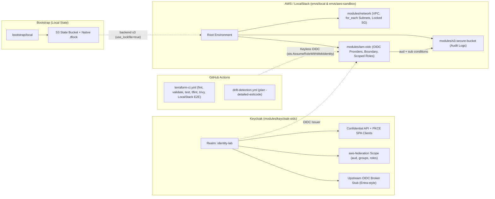

# tf-oidc-identity-stack

A local-first Terraform lab and reference architecture combining least-privilege AWS IAM OIDC federation, VPC networking, S3 remote state with native lockfiles, and declarative Keycloak identity configuration.

**Status:** `Maintained` - local-first Terraform, LocalStack, and Keycloak OIDC federation reference stack.

Everything runs end to end on localhost using LocalStack and Keycloak in containers at zero cloud cost, while keeping a clean root module (`envs/aws-sandbox/`) ready for real AWS accounts with no static AWS access keys.

## Architecture



## Repository Layout

| Path | Role |
| --- | --- |
| `bootstrap/local/` | Standalone local-state stack that provisions the S3 remote state bucket so workload destroys cannot delete their own state store. |
| `envs/local/` | Primary local environment wired to LocalStack (`:4566`) and Keycloak (`:8080`), using S3 remote state with `use_lockfile = true`. |
| `envs/aws-sandbox/` | Real AWS root module reusing the exact same modules with zero hardcoded account IDs or credentials. |
| `modules/s3-secure-bucket/` | Hardened S3 bucket (public access blocked, `BucketOwnerEnforced`, versioning, `AES256` or optional `aws:kms`, noncurrent lifecycle cleanup). |
| `modules/network/` | VPC, IGW, `for_each` public/private subnet maps, locked-down default security group, and scoped TCP 443 proxy security group (no NAT Gateway). |
| `modules/iam-oidc/` | IAM OIDC provider, privilege-escalation-blocking permission boundary, and `for_each` federated roles enforcing `aud` and non-wildcard `sub` claims. |
| `modules/keycloak-oidc/` | Declarative Keycloak realm, roles, group bindings, PKCE clients, AWS STS audience/group/role protocol mappers, and optional upstream OIDC broker. |
| `scripts/verify-local-e2e.sh` | End-to-end verification script covering bootstrap, S3 state migration, idempotency, out-of-band drift injection/remediation, and live OIDC/IAM assertions. |
| `.github/workflows/` | PR CI (`terraform-ci.yml`) and scheduled/manual drift detection (`drift-detection.yml`). |

## Prerequisites

- `terraform` `>= 1.10` (tested on `1.15.9`)
- `podman` + `podman-compose` (or `docker` + `docker compose`, override with `COMPOSE="docker compose"`)
- `aws` CLI v2, `jq`, `curl`
- Optional for local static analysis: `tflint`, `trivy`

## Quickstart (LocalStack + Keycloak)

```bash
# 1. Start LocalStack (4.14.0) and Keycloak (26.8.2) on localhost
make up

# 2. Run the full end-to-end bootstrap, apply, idempotency, and drift test
make test-e2e

# 3. Run all static checks, unit tests, linting, and Trivy security scans
make lint-init
make check
```

To run individual steps manually:

```bash
make bootstrap   # Creates tf-oidc-identity-local-tfstate bucket
make init        # Initializes envs/local against S3 remote backend
make plan        # Saves execution plan to envs/local/tfplan
make apply       # Applies the exact saved plan
make state       # Lists all resources tracked in S3 remote state
make aws-ls      # Inspects buckets, VPC, OIDC providers, and IAM roles
make down        # Stops local containers
```

## Key Design and Security Decisions

- **Native S3 state locking (`use_lockfile = true`):** Uses S3 conditional writes (`If-None-Match: *`) supported in Terraform 1.10+ instead of maintaining a separate DynamoDB lock table, while documenting both approaches.
- **No static cloud credentials:** Federated roles use `sts:AssumeRoleWithWebIdentity`. Module input validation rejects non-HTTPS issuers, malformed SHA-1 thumbprints, and bare `*` subject wildcards.
- **Defense in depth via IAM permission boundaries:** Every federated role carries a boundary that explicitly denies `iam:CreateAccessKey`, `iam:PutRolePermissionsBoundary`, `iam:DeleteRolePermissionsBoundary`, `iam:AttachRolePolicy`, `iam:PutRolePolicy`, and `iam:CreateUser`.
- **Stable state addresses with `for_each`:** Subnets and IAM roles iterate over maps rather than `count` lists so removing an item never triggers index-shift destruction of unrelated resources.
- **Zero-cost sandbox defaults:** S3 buckets default to free SSE-S3 (`AES256`) with optional `kms_key_arn` for production SSE-KMS, and `modules/network` omits paid NAT Gateways.
- **Zero committed secrets:** State files, `.tfvars`, and plan files stay out of git via `.gitignore`; local dev passwords are supplied via environment variables (`TF_VAR_keycloak_admin_password`).

## Walkthroughs and Notes

- [docs/MILESTONE_1_LAB.md](docs/MILESTONE_1_LAB.md): Core workflow, state inspection, drift drill, `moved {}` refactoring, and `import {}`.
- [docs/MILESTONE_2_LAB.md](docs/MILESTONE_2_LAB.md): Remote state separation, native S3 lockfiles, `for_each` patterns, OIDC trust policies, and Keycloak IaC.
- [docs/DESIGN_NOTES.md](docs/DESIGN_NOTES.md): Design notes and technical walkthrough covering state management, module boundaries, drift detection, failure recovery, and identity security tradeoffs.

## License

MIT. See [LICENSE](LICENSE). Copyright (c) 2026 Mariano Gabriel Parra.
